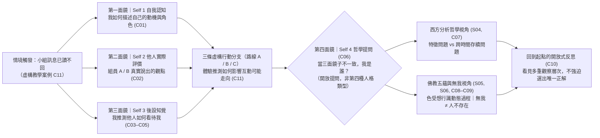

# Perspective-Provenance Graph — 執行與局部回退流程

本專案之 Graph 針對《第四面鏡：我是誰？》跨領域教學的三大核心風險——**「誰在說 vs 誰在猜（Self 2 ≠ Self 3）」、「自創教學框架 vs 原典學說（四面鏡 ≠ 佛教五蘊／Cooley 原文）」、「公開摘要 vs 付費牆全文（誠實揭露驗證範圍）」**——所設計的**視角與來源可追溯狀態圖（Perspective-Provenance Graph）**。

---

## 一、雙層架構：Frame 1（工程與 QA 工作流 A–K）

```mermaid
flowchart LR
    subgraph Lane1["1. 輸入與範圍確認"]
        A["A. 範圍與紅線確認<br/>Scope & Red-Line Alignment"]
    end

    subgraph Lane2["2. 文獻擷取與主張抽取"]
        B["B. 來源探索與擷取<br/>Source Discovery & Ingest"]
        C["C. 證據錨點抽取與正規化<br/>Claim & Anchor Extraction"]
    end

    subgraph Lane3["3. 雙重知識驗證閘門"]
        D{"D. 視角邊界閘門<br/>Self 1 / 2 / 3 Gate"}
        E{"E. 學說歸因與證據閘門<br/>Doctrine / Evidence Gate"}
    end

    subgraph Lane4["4. Wiki 建構與 12 幕對齊"]
        F["F. 增量更新 Markdown Wiki<br/>+ 前置檢查 F<br/>(frontmatter / LaTeX / JSON)"]
        G["G. 12 幕教學腳本與主張對齊<br/>+ 前置檢查 G<br/>(scene_claim_source_coverage)"]
    end

    subgraph Lane5["5. 互動簡報與獨立盲審"]
        H["H. 互動 HTML 建構<br/>+ 前置檢查 H<br/>(ARIA / p-nesting / scope / 真實瀏覽器)"]
        I{"I. 獨立盲審與結構測試<br/>Independent Blind Audit & QA"}
    end

    subgraph Lane6["6. 驗收與發佈"]
        J["J. 證據彙整與錯誤統計<br/>Evidence & Review"]
        K["K. 發佈與人工簽核<br/>Publish & Sign-off"]
    end

    %% 正常前進路徑
    A --> B --> C --> D
    D -- "PASS：視角分離正確" --> E
    E -- "PASS：來源與錨點可核對" --> F
    F --> G --> H --> I
    I -- "ALL PASS" --> J --> K

    %% 局部回退路徑（Targeted Fallbacks）
    D -. "FAIL：Self 2/3 混同或將猜測當事實<br/>僅重寫受影響 Claim (Max 3)" .-> C
    E -. "FAIL：四面鏡誤歸原典或錨點失真<br/>重取來源 / 降級為摘要 (Max 3)" .-> B
    E -. "FAIL：主張超出驗證範圍<br/>縮減 Claim 表述 (Max 3)" .-> C
    I -. "FAIL [Fact/Source]：來源或歸因錯誤<br/>退回 C (或 B)" .-> C
    I -. "FAIL [Pedagogy/Mapping]：跨檔映射或教學跳躍<br/>退回 G (或 F)" .-> G
    I -. "FAIL [UI/A11y/HTML]：無障礙或 DOM 瑕疵<br/>退回 H" .-> H
```

---

## 二、Frame 2：學習者概念流程圖（4-Mirror Learning Concept Map）

---

## 三、節點資訊牆（避免污染）

| 節點 | 可讀取輸入 | 可修改輸出 | 失敗退回目標 |
| :--- | :--- | :--- | :--- |
| **B / C（來源與主張）** | 來源 URL、公開 API、原典文本 | `raw/original/*`、`raw/ingest_manifest.json`、`wiki/claims.json` | 缺證據則降級存取範圍或停機等待人工確認 |
| **F（Wiki 更新）** | 已通過 `D/E` 閘門之 `claims.json` | `wiki/concepts/*.md`、`wiki/sources/*.md`、`slides/wiki.html` | `F`（未通過前置檢查 F 不得進入 `G`） |
| **G（12 幕對齊）** | `wiki/`、`claims.json` | `slides/scene_claim_map.json`、各幕教學文案與對照結構 | `G` 或 `C`（未通過前置檢查 G 不得進入 `H`） |
| **H（互動 HTML）** | 已對齊之 `scene_claim_map.json` 與文案 | `slides/deck.html` | `H`（未通過前置檢查 H 與 `tests/browser_test.py` 真實瀏覽器測試不得進入 `I`） |
| **I（獨立盲審）** | **僅**規則檔、`raw/`、`wiki/`、`slides/` 成品（**禁止讀取生成端自評**） | **唯讀（禁止自行偷改成品）**；僅輸出問題清單（位置、來源、建議退回節點） | 依錯誤類型退回 `C`、`F`、`G` 或 `H` |
